<div align="center">

# HENPROTRUST

**Construção · Remodelação · Manutenção de edifícios — Região Oeste**

Site institucional bilingue (português de Portugal e inglês), com **área de cliente** para aceitar orçamentos online e **painel de gestão** para acompanhar pedidos, orçamentos, obras e clientes.


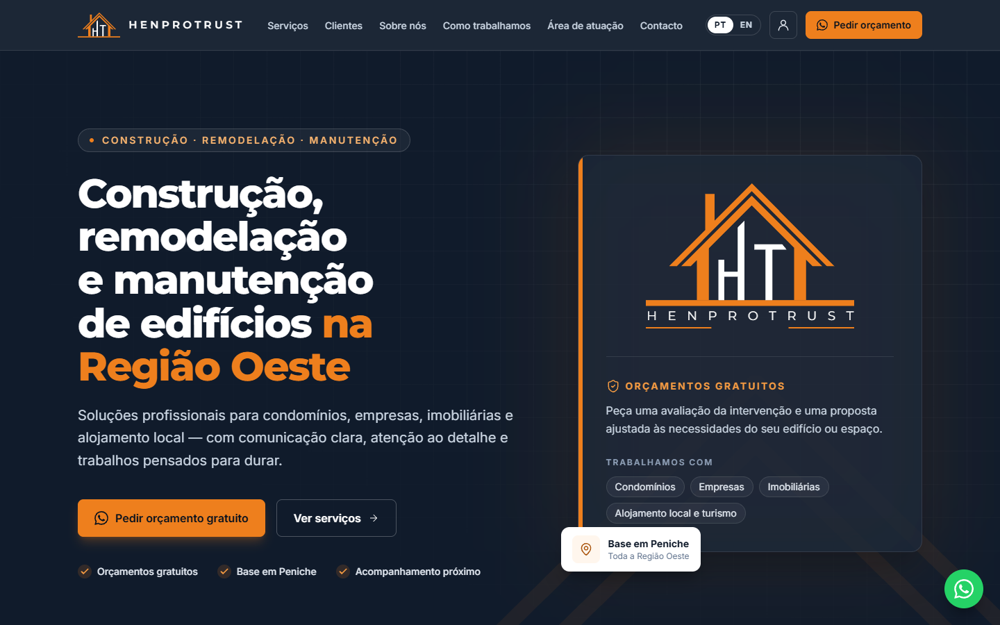

</div>

## Demonstração

### O site


### O sistema: do orçamento à obra

O cliente abre o orçamento na área de cliente e aceita-o online; a gestão vê-o de imediato no painel, a obra é aberta e tudo fica registado na ficha do cliente.

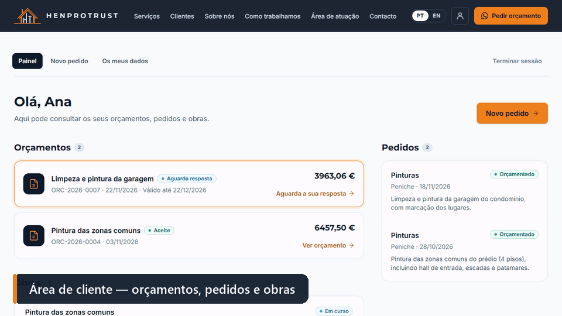

> As imagens usam **dados de demonstração fictícios**.

## O que foi feito

### Site público
- Página única com todas as secções da apresentação institucional: serviços, a quem nos dirigimos, quem somos, como trabalhamos e área de atuação (Peniche e restante Região Oeste).
- **Português de Portugal e inglês** (`/pt` e `/en`), com deteção automática do idioma do browser e seletor que mantém a página atual.
- Logótipo redesenhado em vetor (SVG), nítido em qualquer ecrã, com as cores da marca.
- **WhatsApp em destaque**: botões em todo o site, botão flutuante e formulário de orçamento que abre o WhatsApp com a mensagem já preenchida.
- Totalmente adaptado a telemóvel, com animações suaves e acessível (contraste, navegação por teclado, leitores de ecrã).
- SEO local: metadados nos dois idiomas, `hreflang`, `sitemap.xml`, dados estruturados de empresa e imagem de pré-visualização para partilhas no WhatsApp e redes sociais.
- Conformidade em Portugal: Livro de Reclamações Eletrónico, nota “Chamada para a rede móvel nacional” junto ao telefone e Política de Privacidade (RGPD).

### Área de cliente
- Registo e login seguros, com validação de NIF português e consentimento da Política de Privacidade.
- Pedidos de orçamento online.
- **Orçamento detalhado** (linhas, quantidades, unidades, IVA, total e validade), pronto a imprimir ou guardar em PDF.
- **Aceitar ou recusar o orçamento online**, com confirmação e registo da data e hora.
- Acompanhamento das obras, com as atualizações publicadas pela equipa.
- Gestão dos dados pessoais e da palavra-passe.

### Gestão (`/admin`)
- **Painel** com indicadores: pedidos novos, orçamentos à espera de resposta, valor adjudicado no ano, obras em curso, taxa de aceitação e clientes.
- **Pedidos** com filtros por estado e criação de orçamento a partir do pedido.
- **Editor de orçamentos** com linhas dinâmicas, unidades (m², m linear, hora, verba global…), IVA 23/13/6/0 % e totais calculados na hora; rascunho, envio, retirada e anulação.
- Indicação de quando o cliente **abriu** o orçamento e botão para o **avisar no WhatsApp** com o link direto.
- **Obras** abertas automaticamente quando um orçamento é aceite: estado, datas e atualizações (visíveis ao cliente ou notas internas).
- **Fichas de cliente** com dados, pedidos, orçamentos, obras e **cronologia completa**; criação de contas para clientes que chegam pelo WhatsApp e reposição de palavras-passe.
- **Histórico** de toda a atividade, com filtros.

## Capturas de ecrã

<table>
  <tr>
    <td width="50%">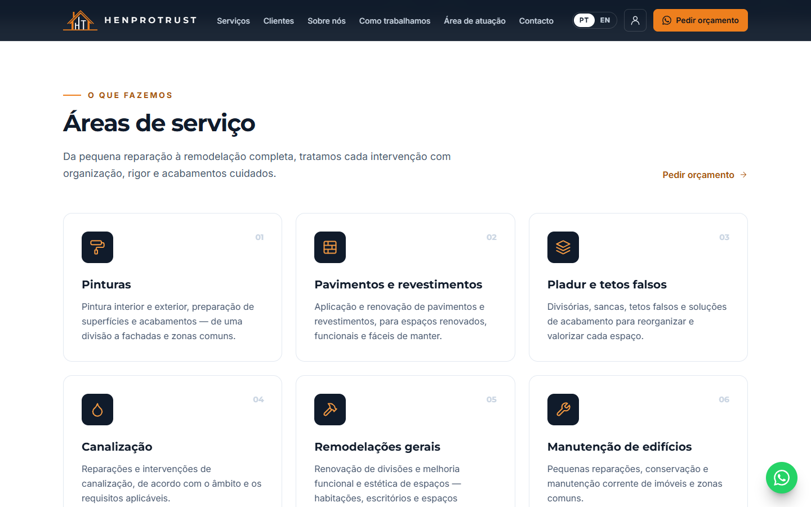<br><sub><b>Serviços</b> — as seis áreas de atuação</sub></td>
    <td width="50%">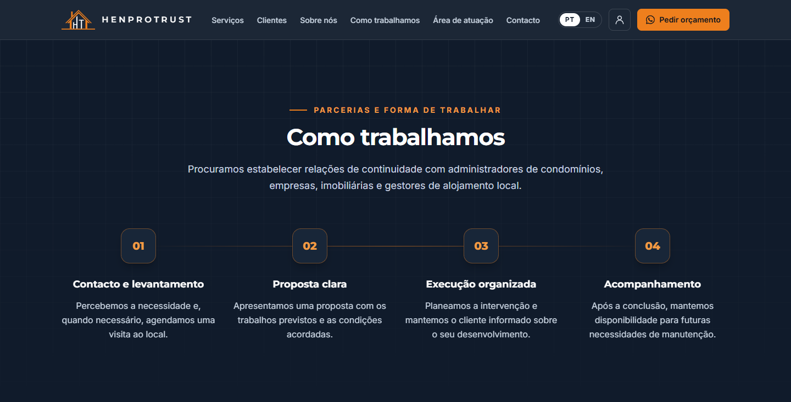<br><sub><b>Como trabalhamos</b> — processo em quatro passos</sub></td>
  </tr>
  <tr>
    <td>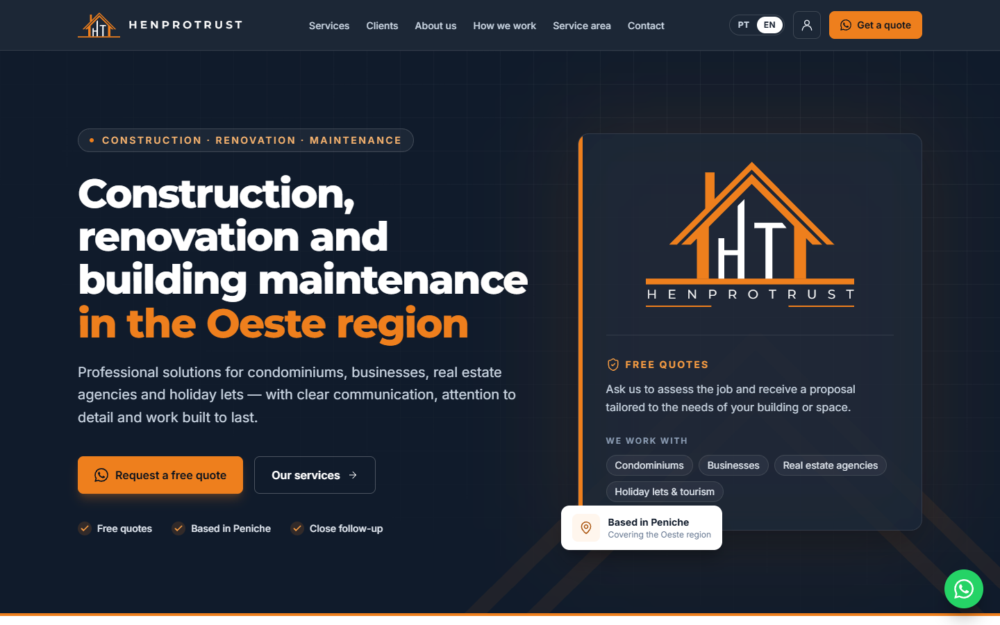<br><sub><b>Versão inglesa</b> — todo o site em inglês</sub></td>
    <td>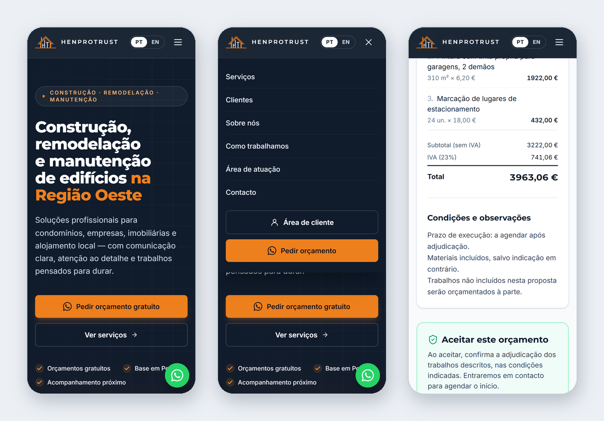<br><sub><b>Telemóvel</b> — início, menu e orçamento</sub></td>
  </tr>
  <tr>
    <td>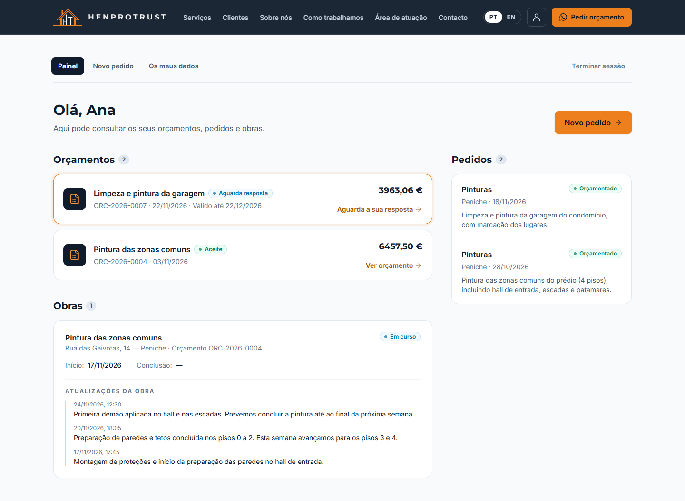<br><sub><b>Área de cliente</b> — orçamentos, pedidos e obras</sub></td>
    <td>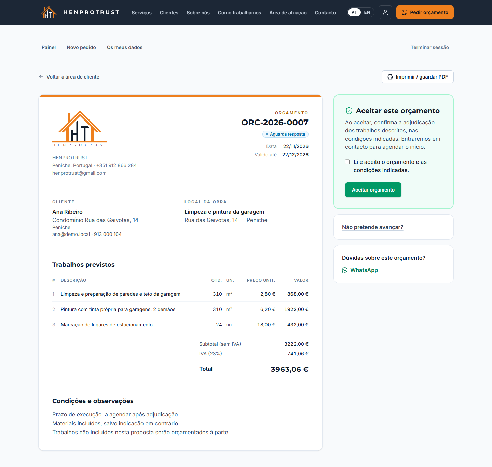<br><sub><b>Orçamento</b> — consultar e aceitar online</sub></td>
  </tr>
  <tr>
    <td>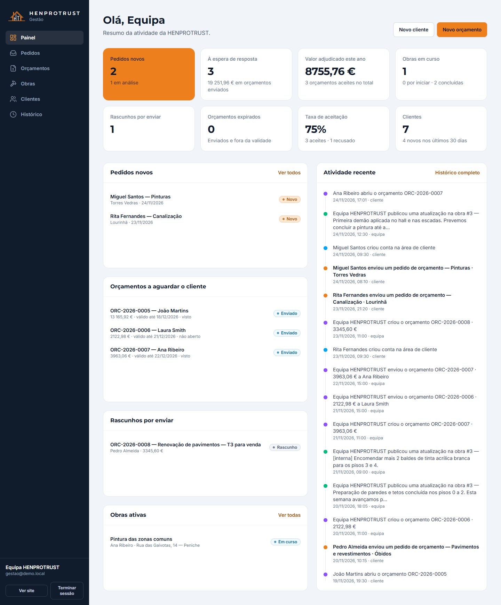<br><sub><b>Gestão</b> — indicadores e atividade recente</sub></td>
    <td>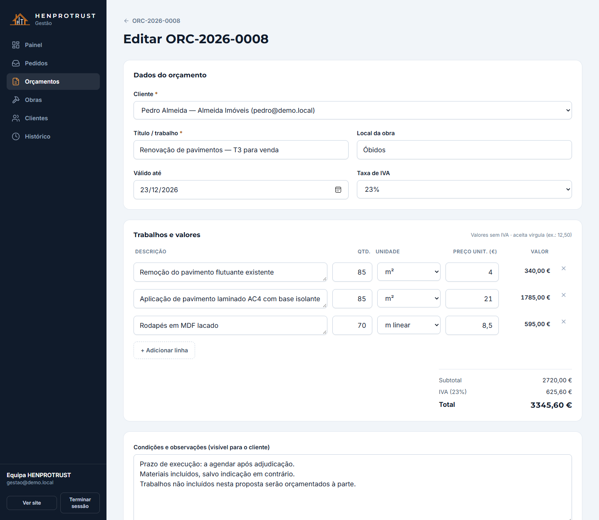<br><sub><b>Editor de orçamentos</b> — linhas, IVA e totais</sub></td>
  </tr>
  <tr>
    <td>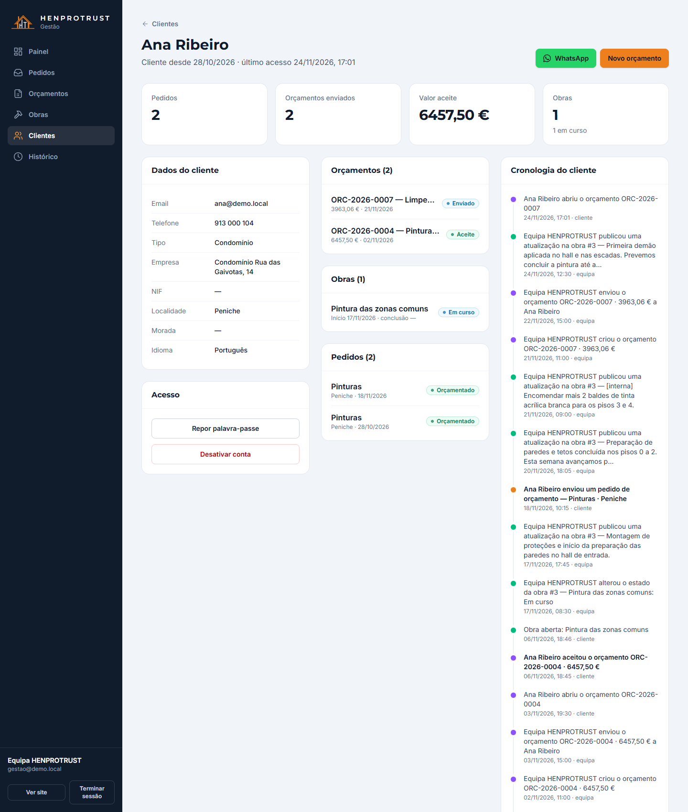<br><sub><b>Ficha de cliente</b> — com cronologia completa</sub></td>
    <td>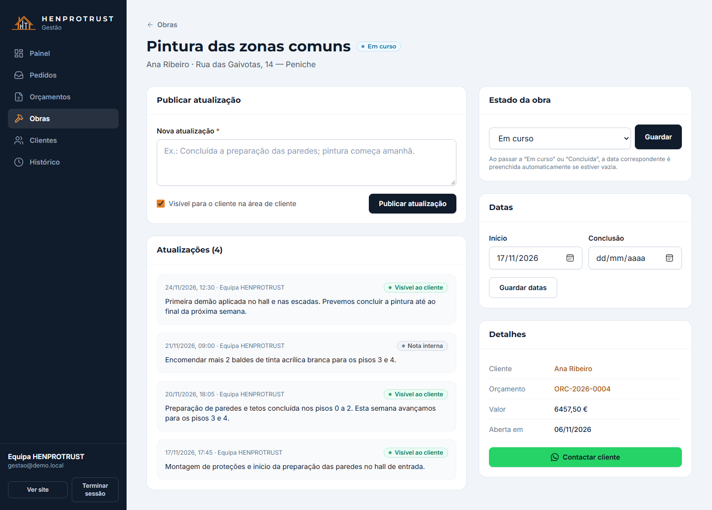<br><sub><b>Obra</b> — estado, datas e atualizações</sub></td>
  </tr>
</table>

## Como funciona

1. **Pedido** — o cliente cria conta e faz um pedido de orçamento. Se chegar pelo WhatsApp, a equipa cria-lhe a conta em *Gestão → Clientes → Novo cliente* e envia-lhe o acesso pelo próprio WhatsApp.
2. **Orçamento** — a equipa prepara o orçamento, guarda como rascunho e envia. O botão *Avisar cliente no WhatsApp* manda-lhe o link.
3. **Aceitação** — o cliente consulta e aceita (ou recusa) na área de cliente. Fica registada a data e hora.
4. **Obra** — cada orçamento aceite abre uma obra; a equipa atualiza o estado, as datas e publica atualizações que o cliente vê na sua área.
5. **Histórico** — tudo fica registado, no histórico geral e na ficha de cada cliente.

## Tecnologia

| | |
| --- | --- |
| Framework | Next.js 16 (App Router, Cache Components, Server Actions) e React 19 |
| Linguagem | TypeScript |
| Estilos | Tailwind CSS 4 |
| Base de dados | SQLite / libSQL — ficheiro local ou [Turso](https://turso.tech) na nuvem |
| Validação | Zod |
| Segurança | Palavras-passe com scrypt, sessões em cookie httpOnly, bloqueio após tentativas falhadas, verificação de permissões no servidor em cada ação |

## Primeira utilização

```bash
npm install
npm run admin:create -- --email o-seu-email@exemplo.pt --name "O seu nome"
npm run dev
```

O comando `admin:create` cria o administrador e mostra uma palavra-passe gerada (guarde-a). Para escolher a palavra-passe, acrescente `--password "…"` (mínimo 10 caracteres). O mesmo comando serve para repor a palavra-passe de um administrador.

Abrir <http://localhost:3000> (site) e <http://localhost:3000/admin> (gestão).

## Onde editar

| O quê | Ficheiro |
| --- | --- |
| Telefone, WhatsApp, email, localidades, NIF e alvará | `lib/site.ts` |
| Textos em português / inglês | `lib/dictionaries/pt.ts` / `en.ts` |
| Política de Privacidade | `lib/legal/privacy.ts` |
| Cores da marca | `app/globals.css` (bloco `@theme`) |
| Logótipo (SVG) | `components/logo.tsx` e `app/icon.svg` |

Os dois ficheiros de textos têm de manter a mesma estrutura (o TypeScript avisa se faltar algum texto em inglês).

## Dados e publicação

- Localmente, a base de dados fica em `data/henprotrust.db`, que **não** vai para o git (contém dados pessoais de clientes). Faça cópias de segurança deste ficheiro.
- Na **Vercel** (sem disco permanente), ligue uma base Turso em *Storage → Turso*; as variáveis `TURSO_DATABASE_URL` e `TURSO_AUTH_TOKEN` são reconhecidas automaticamente. Em alternativa, defina `DATABASE_URL` e `DATABASE_AUTH_TOKEN` (ver `.env.example`). O esquema é criado automaticamente.
- Defina `SITE_URL` com o domínio final (ex.: `https://www.henprotrust.pt`) — usado nos links canónicos, no `sitemap.xml`, na imagem de partilha e nos links enviados por WhatsApp.
- `npm run build` e `npm start` num servidor com Node.js, ou importar o repositório na Vercel.
